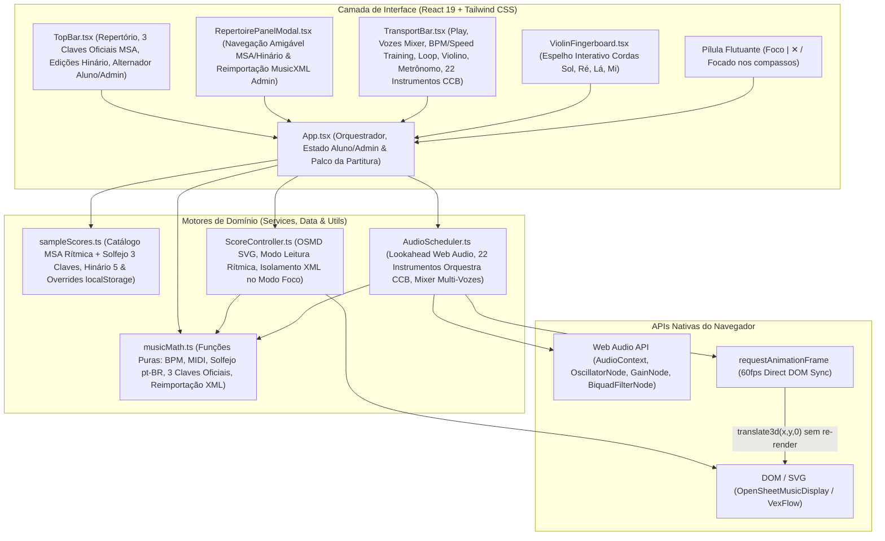
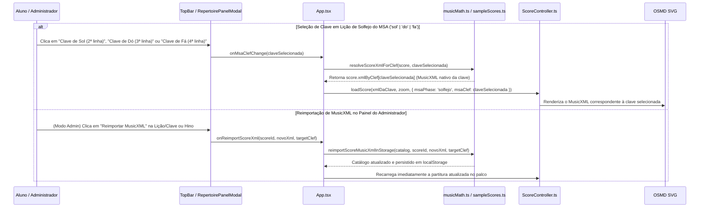
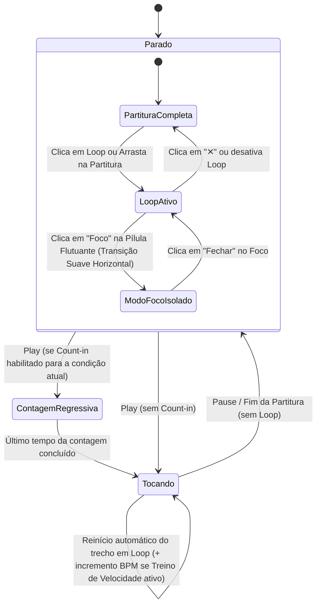

# ARCHITECTURE.md — Arquitetura Viva do SliceScore Studio

## 1. Visão Geral do Sistema
O **SliceScore Studio** é uma Single Page Application (SPA) modular em React + TypeScript projetada para estudo musical interativo de alta precisão do **Hinário 5 da CCB** (múltiplas edições: Cordas, Órgão, Dó, Si♭, Mi♭, Fá e Tubas) e das **113 Lições do MSA** (Método Simplificado de Aprendizagem Musical). A arquitetura separa estritamente três camadas:
1. **Camada de Apresentação Minimalista e Navegação Amigável (React UI):** Componentes enxutos (`TopBar`, `RepertoirePanelModal`, `TransportBar`, `ViolinFingerboard`), alternador de perfil (`Visão do Aluno` vs `Painel do Administrador`) e palco de partitura 100% branco (`App.tsx`).
2. **Camada de Controle Gráfico, Resolução MusicXML por Clave e Partitura (`ScoreController.ts` + `musicMath.ts`):** Wrapper especializado sobre o `opensheetmusicdisplay` (OSMD) responsável por parsing de MusicXML, busca direta do MusicXML correspondente a cada uma das **3 Claves Oficiais (`Clave de Sol` na 2ª linha, `Clave de Dó` na 3ª linha e `Clave de Fá` na 4ª linha)** via `xmlByClef`, pós-processamento SVG para **Leitura Rítmica** em linha única (sem clave e sem pentagrama), filtragem de compassos para o Modo Foco, extração de coordenadas (`MeasureBoundingBox` e `ScoreSliceEvent`) e coloração direta de cabeças de nota (`.vf-notehead path`).
3. **Camada de Áudio da Orquestra CCB e Tempo Real (`AudioScheduler.ts` + `musicMath.ts`):** Motor de agendamento lookahead baseado em `AudioContext.currentTime` com síntese realista para as **4 famílias da Orquestra CCB (22 instrumentos)**, mixer de vozes por pentagrama (Solo/Mute), metrônomo subdividido, contagem regressiva (Count-in) e treino de velocidade automático.

---

## 2. Diagrama de Componentes (`flowchart TD`)

---

## 3. Fluxo de Seleção das 3 Claves Oficiais e Reimportação MusicXML pelo Administrador

---

## 4. Máquina de Estados de Reprodução, Loop e Modo Foco (`stateDiagram-v2`)

