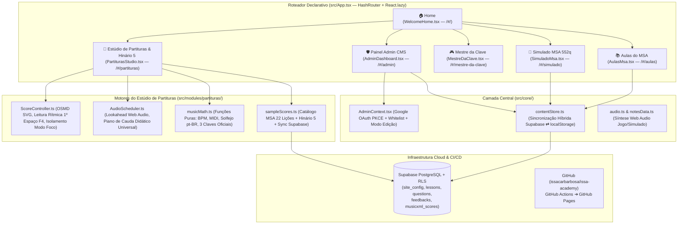
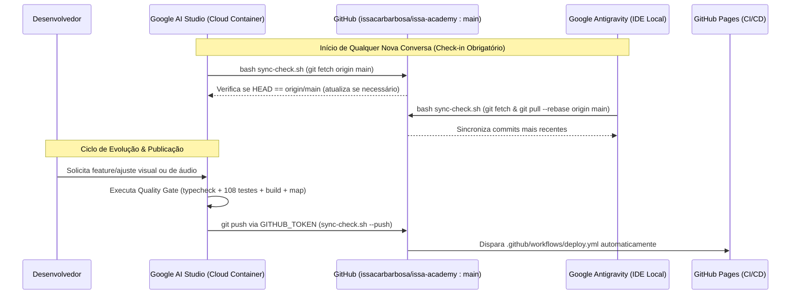
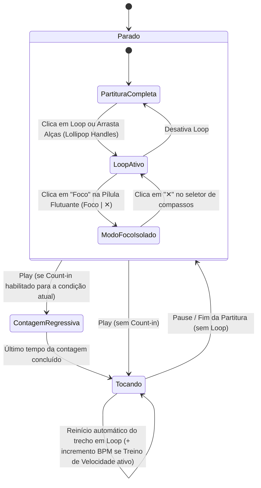

# ARCHITECTURE.md — Arquitetura Viva do Ecossistema Issa Academy (v1.4.1)

## 1. Visão Geral do Sistema
O **Issa Academy** é uma Single Page Application (SPA) modular e offline-first (PWA) em **React 19 + TypeScript + Tailwind CSS v4** voltada ao ensino gamificado e interativo do **MSA (Método Simplificado de Aprendizagem Musical)** e do **Hinário 5 da CCB**.

O projeto opera em **arquitetura de desenvolvimento híbrida (`Google AI Studio ⇄ GitHub ⇄ Antigravity`)**, compartilhando uma única fonte da verdade na branch `main` de `https://github.com/issacarbarbosa/issa-academy` e banco em nuvem **Supabase Cloud (`pcwmafuykwqxoivedpbn`)** com fallback transparente para `localStorage`.

---

## 2. Diagrama Geral dos 6 Módulos e Camada de Dados (`flowchart TD`)

---

## 3. Fluxo de Sincronização Híbrida (`Google AI Studio ⇄ GitHub ⇄ Antigravity`)

---

## 4. Máquina de Estados do Estúdio de Partituras (`stateDiagram-v2`)

