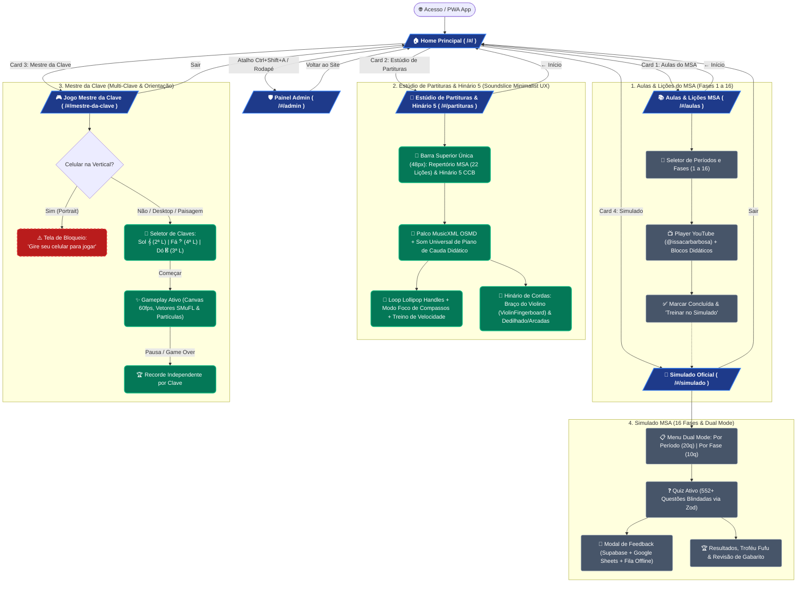

# Mapa de Experiência e Fluxo do Usuário: Issa Academy (v1.4.1)

Este documento mapeia a arquitetura de navegação, transições de estado e guardas de UX da plataforma **Issa Academy**, cobrindo os **4 módulos de estudo do aluno** (`Aulas do MSA`, `Estúdio de Partituras & Hinário 5`, `Mestre da Clave` e `Simulado MSA`) e o **Painel Administrativo Híbrido (`/#/admin`)**.

---

## 🗺️ Diagrama de Fluxo Completo (Mermaid.js)

---

*Mapa de fluxo atualizado em: 30/10/2026 (v1.4.1).*
