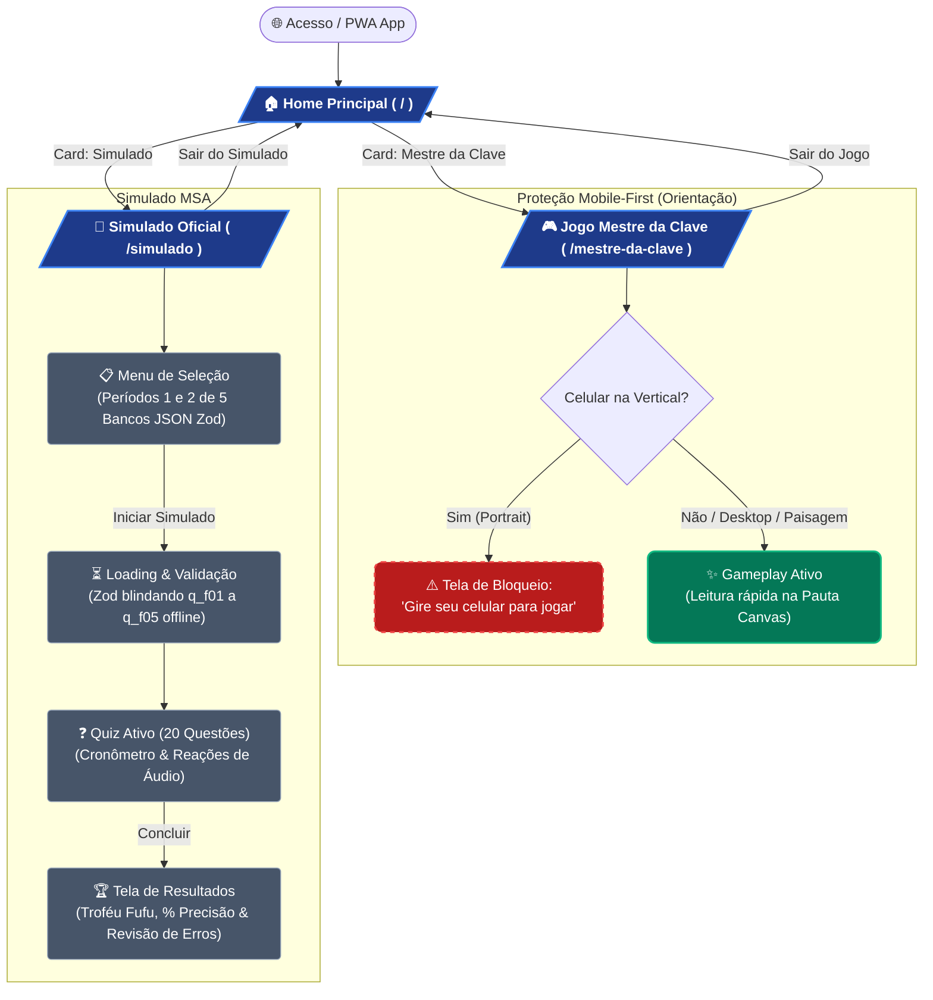

# Mapa de Experiência e Fluxo do Usuário: Issa Academy

Este documento mapeia a arquitetura de navegação, transições de estado e guardas de UX (User Experience) da plataforma **Issa Academy**, com foco no jogo **Mestre da Clave** e no **Simulado MSA**.

---

## 🗺️ Diagrama de Fluxo (Mermaid.js)

---

## 🧭 Legenda da Arquitetura de UX

| Elemento / Cor | Significado Arquitetural | Exemplo no Projeto |
| :--- | :--- | :--- |
| **🟦 Rotas da SPA (Azul)** | Telas de nível superior configuradas em `App.tsx` com `React.lazy` e Code Splitting. | `/`, `/simulado`, `/mestre-da-clave` |
| **🟩 Ambientes Interativos (Verde)** | Telas de alta interatividade com síntese acústica em tempo real via Web Audio API. | Gameplay do Mestre da Clave |
| **🟥 Guardas de UX (Vermelho Tracejado)** | Bloqueios condicionais de interface que previnem experiências ruins no celular. | Componente `<OrientationGuard />` bloqueando orientação retrato no jogo |
| **⬛ Estados e Telas Internas (Cinza)** | Sub-telas controladas por máquina de estados interna sem transição de URL. | Menu, Loading, Quiz e Resultados do Simulado |

---

*Mapa de fluxo atualizado em: 16/10/2026.*
